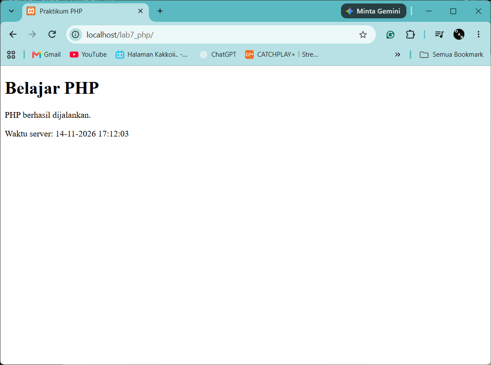
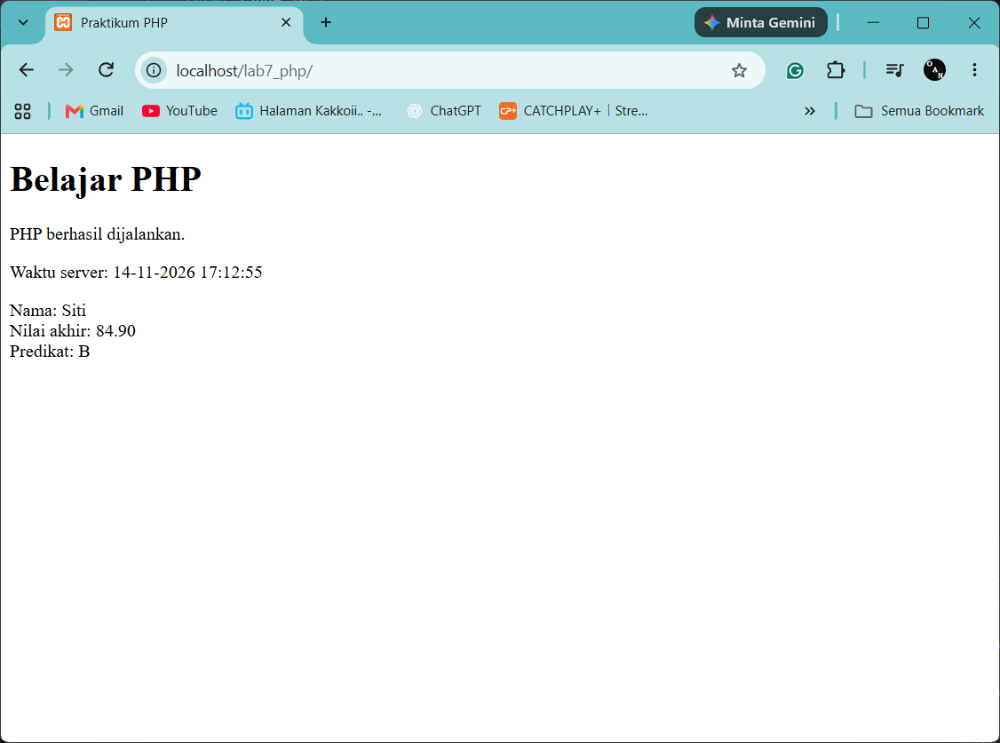
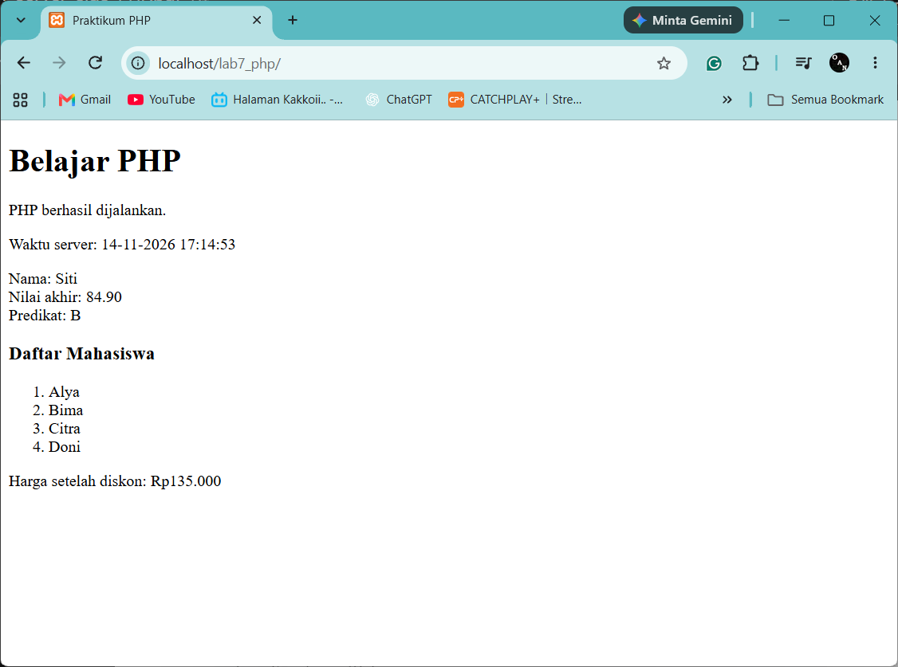
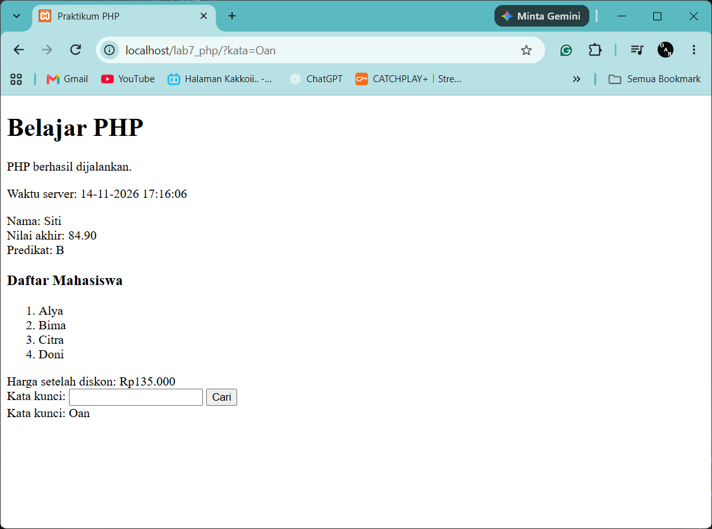
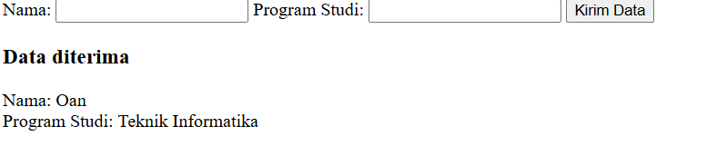
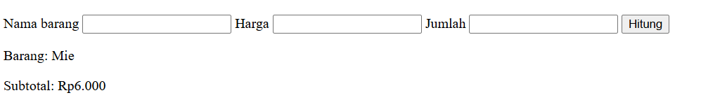
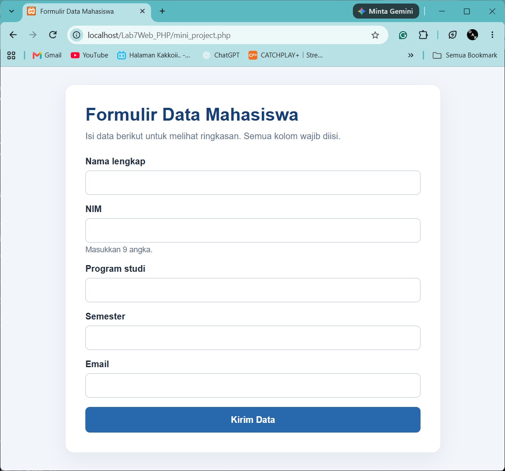
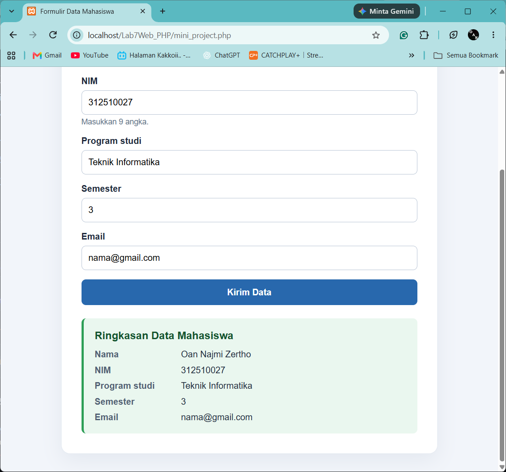
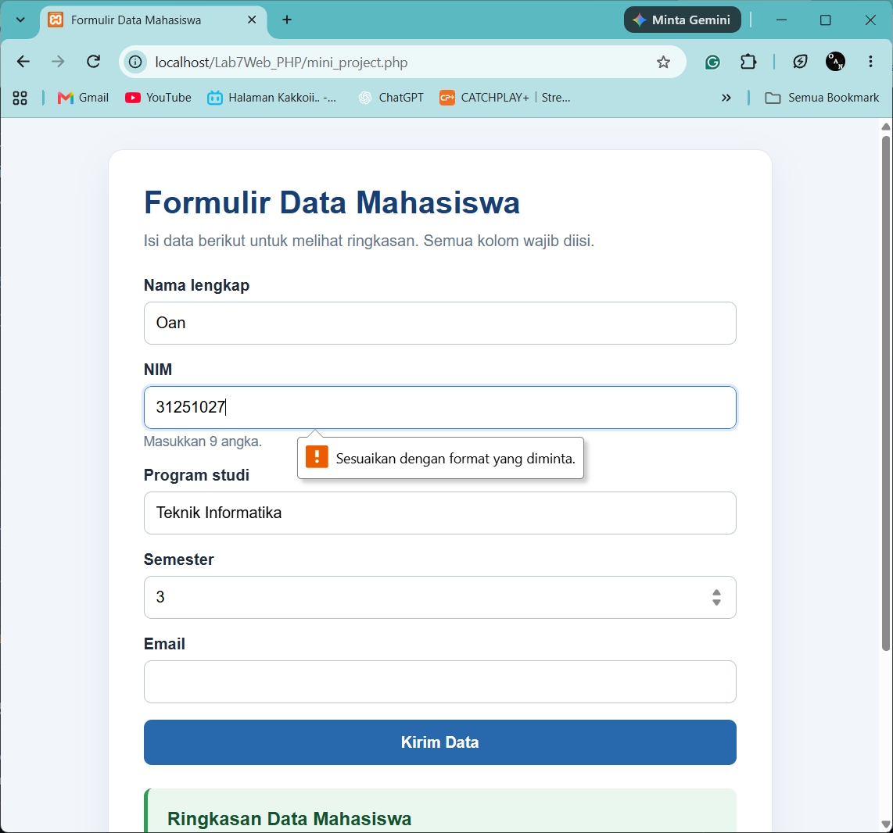

# Langkah Praktikum 7 - Pemrograman Web

**Nama:** Oan Najmi Zertho  
**NIM/Kelas:** 321510027 / I.25.3A  
**Prodi:** Teknik Informatika  
**Mata Kuliah:** Pemrograman Web  
**Dosen:** Agung Nugroho S.Kom, M.Kom

## Langkah Praktikum - Pemrograman Server-Side dengan PHP

Praktikum ini mempelajari cara PHP memproses data di server, mulai dari sintaks dasar, variabel, percabangan, array, perulangan, function, hingga form GET dan POST. Latihan 1 sampai 7 dikerjakan pada `index.php`. Mini Project Formulir Data Mahasiswa menggunakan `mini_project.php` agar pemrosesannya terpisah dari latihan.

## Persiapan lingkungan dan struktur proyek

Pastikan XAMPP terpasang dan layanan Apache dapat dijalankan. Simpan proyek dalam direktori `htdocs`.

```text
Lab7Web_PHP/
├── index.php          # Latihan 1-7
├── mini_project.php   # Mini Project Formulir Data Mahasiswa
├── README.md
└── screenshots/       # Bukti tampilan praktikum
```

Jalankan Apache dari XAMPP Control Panel, lalu buka `http://localhost/Lab7Web_PHP/` untuk latihan dan `http://localhost/Lab7Web_PHP/mini_project.php` untuk mini project. File PHP dijalankan melalui server lokal, bukan dibuka dengan klik ganda.

## Latihan 1 - Menjalankan PHP

```php
echo "<p>PHP berhasil dijalankan.</p>";
echo "<p>Waktu server: " . date("d-m-Y H:i:s") . "</p>";
```

- `echo` mengirim teks atau markup HTML ke halaman yang diterima browser.
- `date("d-m-Y H:i:s")` membuat waktu saat ini berdasarkan waktu server.
- Kode PHP diproses di server; browser hanya menerima hasil HTML-nya.



## Latihan 2 - Variabel, operator, dan percabangan

```php
$nilaiAkhir = ($tugas * 0.30) + ($uts * 0.30) + ($uas * 0.40);

if ($nilaiAkhir >= 85) {
    $predikat = "A";
} elseif ($nilaiAkhir >= 75) {
    $predikat = "B";
} elseif ($nilaiAkhir >= 60) {
    $predikat = "C";
} else {
    $predikat = "D";
}
```

- Variabel PHP diawali `$`; pada latihan, `$tugas`, `$uts`, dan `$uas` menyimpan nilai komponen.
- Operator perkalian dan penjumlahan menghitung nilai akhir dengan bobot tugas 30%, UTS 30%, dan UAS 40%.
- Rangkaian `if`, `elseif`, dan `else` memilih predikat dari nilai tertinggi yang terpenuhi.
- `number_format($nilaiAkhir, 2)` menampilkan hasil dengan dua angka desimal.



## Latihan 3 - Array dan perulangan

```php
$mahasiswa = ["Alya", "Bima", "Citra", "Doni"];
echo "<h3>Daftar Mahasiswa</h3><ol>";
foreach ($mahasiswa as $nama) {
    echo "<li>" . htmlspecialchars($nama) . "</li>";
}
echo "</ol>";
```

- Array `$mahasiswa` menyimpan beberapa nama dalam satu variabel.
- `foreach` mengambil setiap elemen array secara berurutan dan menaruhnya dalam `$nama`.
- Tag `<ol>` dan `<li>` membentuk daftar bernomor.
- `htmlspecialchars()` mengubah karakter khusus agar isi nama tidak dibaca sebagai markup HTML.


## Latihan 4 - Membuat function

```php
function hitungDiskon($harga, $persen)
{
    $potongan = $harga * ($persen / 100);
    return $harga - $potongan;
}

$hargaAkhir = hitungDiskon(150000, 10);
```

- `function hitungDiskon(...)` membuat fungsi yang dapat dipanggil dengan harga dan persentase diskon berbeda.
- `$potongan` berisi nilai diskon, yaitu harga dikali persentase dalam bentuk pecahan.
- `return` mengembalikan harga setelah diskon kepada pemanggil fungsi.
- `number_format($hargaAkhir, 0, ",", ".")` menampilkan nilai sebagai angka Rupiah tanpa pecahan.



## Latihan 5 - Memproses form dengan GET

```html
<form method="GET" action="">
    <label for="kata">Kata kunci:</label>
    <input id="kata" name="kata" type="text">
    <button type="submit">Cari</button>
</form>
```

```php
if (isset($_GET["kata"])) {
    $kata = trim($_GET["kata"]);
    echo "Kata kunci: " . htmlspecialchars($kata, ENT_QUOTES, "UTF-8");
}
```

- `method="GET"` mengirim nilai sebagai parameter URL, menggunakan nama yang ditetapkan oleh atribut `name` (di sini `kata`).
- `isset($_GET["kata"])` memastikan parameter tersedia sebelum dibaca.
- `trim()` membuang spasi di awal dan akhir masukan.
- `htmlspecialchars(..., ENT_QUOTES, "UTF-8")` mengamankan teks saat ditampilkan kembali, termasuk tanda kutip.
- GET cocok untuk pencarian yang boleh terlihat di URL; jangan gunakan untuk kata sandi atau data sensitif.



## Latihan 6 - Memproses form dengan POST

```php
if ($_SERVER["REQUEST_METHOD"] === "POST") {
    $nama = trim($_POST["nama"] ?? "");
    $prodi = trim($_POST["prodi"] ?? "");

    if ($nama === "" || $prodi === "") {
        echo "<p>Semua kolom wajib diisi.</p>";
    } else {
        echo "Nama: " . htmlspecialchars($nama, ENT_QUOTES, "UTF-8");
        echo "<br>Program Studi: " . htmlspecialchars($prodi, ENT_QUOTES, "UTF-8");
    }
}
```

- `$_SERVER["REQUEST_METHOD"]` memastikan pemrosesan hanya dilakukan setelah form dikirim dengan POST.
- `$_POST[... ] ?? ""` memberi nilai kosong jika suatu field tidak dikirim.
- `trim()` membantu menolak masukan yang hanya terdiri dari spasi.
- Server tetap memvalidasi data walaupun form HTML memakai `required`, karena pemeriksaan browser dapat dilewati.
- `htmlspecialchars()` digunakan sebelum nilai pengguna dimasukkan ke dalam HTML.



## Latihan 7 - Pengolahan data sederhana

```php
$barang = trim($_POST["barang"] ?? "");
$hargaInput = $_POST["harga"] ?? "";
$jumlahInput = $_POST["jumlah"] ?? "";

if ($barang === "" || !is_numeric($hargaInput) ||
    !ctype_digit((string) $jumlahInput) ||
    (float) $hargaInput < 0 || (int) $jumlahInput < 1) {
    $error = "Periksa kembali nama barang, harga, dan jumlah.";
} else {
    $harga = (float) $hargaInput;
    $jumlah = (int) $jumlahInput;
    $subtotal = $harga * $jumlah;
}
```

- `is_numeric()` memeriksa harga bisa dibaca sebagai angka.
- `ctype_digit()` memastikan jumlah berisi digit bilangan bulat, sedangkan perbandingan memastikan jumlah minimal satu.
- Harga tidak boleh negatif.
- Jika valid, PHP mengalikan harga dengan jumlah untuk memperoleh subtotal.
- Ringkasan transaksi menampilkan nama barang dan subtotal; nama barang di-escape sebelum ditampilkan.



## Mini Project - Formulir Data Mahasiswa

Mini project menerima nama, NIM, program studi, semester, dan email. Form memakai POST. Kode pemrosesan dan validasi diletakkan sebelum HTML, lalu tampilan form dan hasil ditulis sesudahnya agar tanggung jawabnya lebih mudah diikuti.

### 1. Membaca dan membersihkan nilai form

```php
if ($_SERVER['REQUEST_METHOD'] === 'POST') {
    foreach (array_keys($input) as $field) {
        $input[$field] = trim((string) ($_POST[$field] ?? ''));
    }
}
```

- `$input` menampung nilai awal untuk semua kolom agar form dapat diisi kembali setelah validasi gagal.
- Pemeriksaan metode memastikan kode hanya memproses saat form dikirim.
- `trim()` menghapus spasi tepi; konversi string dan nilai cadangan mencegah akses field yang tidak tersedia.

### 2. Validasi server-side

```php
if ($input['nama'] === '') {
    $errors[] = 'Nama wajib diisi.';
}
if (!preg_match('/^[0-9]{9}$/', $input['nim'])) {
    $errors[] = 'NIM harus terdiri dari 9 angka.';
}
if (!ctype_digit($input['semester']) ||
    (int) $input['semester'] < 1 || (int) $input['semester'] > 14) {
    $errors[] = 'Semester harus berupa bilangan bulat dari 1 sampai 14.';
}
if (!filter_var($input['email'], FILTER_VALIDATE_EMAIL)) {
    $errors[] = 'Masukkan alamat email dengan format yang valid.';
}
```

- Pesan kesalahan ditambahkan ke array `$errors`, sehingga lebih dari satu masalah dapat dilaporkan pada satu pengiriman.
- `preg_match()` menerapkan ketentuan NIM yang dipilih untuk latihan ini: tepat 9 angka.
- `ctype_digit()` dan batas 1-14 memeriksa semester berupa bilangan bulat pada rentang yang diminta modul.
- `filter_var(..., FILTER_VALIDATE_EMAIL)` memeriksa format alamat email.
- Program studi juga wajib diisi. Jika tidak ada error, nilai yang sudah lolos validasi dipindahkan ke `$data` untuk ditampilkan.

### 3. Form POST dan pengisian ulang nilai

```html
<form method="POST" action="">
    <label for="nama">Nama lengkap</label>
    <input id="nama" name="nama" type="text" required>

    <label for="semester">Semester</label>
    <input id="semester" name="semester" type="number"
           min="1" max="14" step="1" required>

    <button type="submit">Kirim Data</button>
</form>
```

- Field lain pada form menggunakan nama `nim`, `prodi`, dan `email` agar cocok dengan kunci data yang diperiksa PHP.
- Atribut `required`, `pattern`, `min`, dan `max` membantu memberi petunjuk di browser; validasi PHP tetap dijalankan saat POST diterima.
- Nilai yang sudah dikirim dipertahankan pada kolom setelah kesalahan agar pengguna tidak perlu mengetik ulang semuanya.

### 4. Menampilkan error dan ringkasan

```php
<?php foreach ($errors as $error): ?>
    <li><?= e($error) ?></li>
<?php endforeach; ?>

<?php if ($data !== null): ?>
    <dd><?= e($data['nama']) ?></dd>
    <dd><?= e($data['nim']) ?></dd>
<?php endif; ?>
```

- Loop menampilkan setiap pesan error jika data tidak valid.
- Ringkasan hanya muncul jika `$data` berisi hasil yang valid.
- Fungsi `e()` memanggil `htmlspecialchars()` dengan `ENT_QUOTES` dan UTF-8 untuk mengamankan teks pengguna saat dirender sebagai HTML.
- Tampilan memakai elemen `<dl>`, `<dt>`, dan `<dd>` untuk menyusun label dan nilai data mahasiswa.







### Contoh pengujian input

| Kasus | Contoh | Hasil yang diharapkan |
|---|---|---|
| Valid 1 | Nama `Alya Putri`, NIM `321510027`, prodi `Teknik Informatika`, semester `3`, email `alya@example.com` | Ringkasan seluruh data ditampilkan. |
| Valid 2 | Nama `Bima`, NIM `123456789`, prodi `Sistem Informasi`, semester `14`, email `bima@example.id` | Data diterima; semester 14 termasuk batas atas. |
| Tidak valid 1 | Semester `0` atau `15` | Pesan bahwa semester harus berada pada rentang 1-14. |
| Tidak valid 2 | NIM `12345` atau email `bima@` | Pesan validasi NIM dan/atau email ditampilkan. |

## Ringkasan Hasil

Latihan 1-7 memperagakan dasar pemrograman PHP, pemrosesan form, dan pengolahan data sederhana. Mini project menggabungkan form POST, validasi di server, pelaporan beberapa kesalahan, dan penampilan ringkasan dengan escaping output. Screenshot untuk latihan dan mini project tersimpan di folder `screenshots/`.
